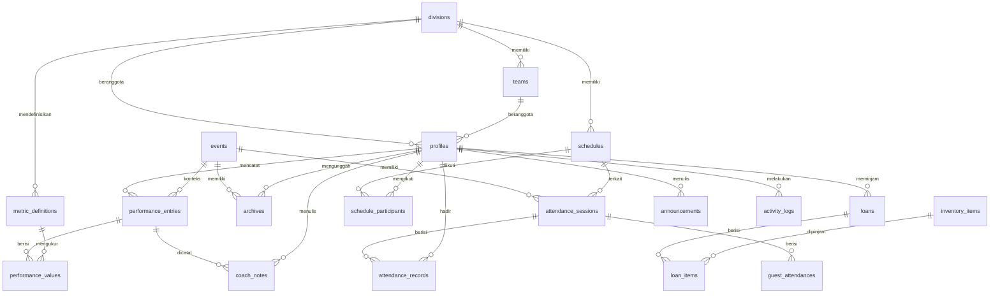

# Gaming Garage UTDI — Dokumen Perancangan Sistem

Versi 1.1 · 9 November 2026 · Berisi PRD, alur pengguna, ERD, aturan akses, dan fase pengerjaan. Dokumen ini adalah sumber kebenaran tunggal untuk seluruh pengerjaan.

## 1. Keputusan yang sudah final

- Landing page yang ada (https://jeppp.is-a.dev/gaming-garage-utdi/) dikembangkan menjadi sistem manajemen komunitas. Desain landing tidak diubah, hanya ditambah tombol **Login** di pojok kanan atas navbar.
- Ada **4 role berakun**: Manajemen, Atlet, Member, Dosen. Dosen **read-only**. **Tamu** tidak punya akun, hanya mengisi presensi.
- Divisi atlet ada 5: Mobile Legends, PES/eFootball, Valorant, Free Fire, Tekken. Divisi non-esport (Game Developer, Social Media, Event & Talent) berisi Member.
- **Streak dan badge dihapus.** Yang tersisa adalah log aktivitas.
- Presensi memakai **QR biasa** dengan kode sesi (bagian 5). Tidak ada validasi WiFi, IP, atau lokasi.
- Performa atlet bisa dilihat oleh: atlet itu sendiri, rekan satu tim, Manajemen, dan Dosen.
- Backend memakai Supabase (Auth, Postgres, Storage, Row Level Security). Frontend tetap statis.
- Tampilan frontend mengikuti seluruh gaya landing page (warna, font, kartu, tombol, efek) dan diambil langsung dari CSS repo.

## 2. Ruang lingkup

**Termasuk (in scope):** login multi-role, CMS landing page, manajemen akun, jadwal atlet, presensi (Atlet, Member, Staf, Tamu), pencatatan dan analisis performa, peminjaman barang, arsip dokumen, pengumuman, log aktivitas, dashboard per role.

**Tidak termasuk (out of scope):** streak, badge, gamifikasi, validasi WiFi/IP, geolokasi/GPS, aplikasi mobile native, chat, pembayaran, integrasi otomatis ke API game untuk menarik statistik, notifikasi push, pendaftaran turnamen di dalam sistem (tetap lewat Linktree), multi-bahasa.

## 3. Aturan wajib untuk agent (anti-halusinasi)

1. Dokumen ini satu-satunya sumber kebenaran. Tabel, kolom, role, enum, halaman, dan fitur yang tidak tertulis di sini **tidak boleh ditambahkan**.
2. Jika ada hal ambigu atau belum tercakup, **berhenti dan bertanya**, jangan menebak.
3. Jangan mengubah desain atau section landing page yang ada. Perubahan yang diizinkan hanya: tombol Login, dan mengganti data statis section Turnamen, Aktivitas, Divisi, serta kontak menjadi data dinamis dengan tampilan yang tetap sama.
4. Warna, font, dan komponen UI diambil dari CSS repo, tidak boleh membuat palet baru.
5. Hak akses ditegakkan di database lewat RLS, bukan hanya dengan menyembunyikan menu.
6. Nilai turunan (status terlambat, persentase hadir, skor relatif performa) **dihitung saat dibaca, tidak disimpan**.
7. Kerjakan per tahap. Selesaikan syarat selesai satu tahap sebelum lanjut.
8. Dilarang menambah library, layanan, atau dependensi di luar bagian 13 tanpa persetujuan.
9. Dilarang membuat fitur streak, badge, atau geolokasi.
10. Seluruh teks antarmuka berbahasa Indonesia.

## 4. Role dan matriks hak akses

Keterangan: C = buat, R = lihat, U = ubah, D = hapus, “milik sendiri” = hanya data milik user itu.

| Modul | Manajemen | Atlet | Member | Dosen | Tamu |
|---|---|---|---|---|---|
| Landing page publik | R | R | R | R | R |
| Kelola konten landing | CRUD | – | – | – | – |
| Akun dan persetujuan | CRUD | – | – | – | – |
| Profil | R semua, U semua | R, U milik sendiri (nama, jurusan) | R, U milik sendiri (nama, jurusan) | R milik sendiri | – |
| Jadwal atlet | CRUD | R milik sendiri | R milik sendiri | R semua | – |
| Sesi presensi | CRUD | – | – | R | – |
| Check-in presensi | Input manual | C milik sendiri | C milik sendiri | – | Form tamu |
| Rekap presensi | R semua | R milik sendiri | R milik sendiri | R semua | – |
| Performa | R semua, verifikasi | C, R, U milik sendiri (selama pending), R rekan satu tim | – | R semua | – |
| Catatan pelatih | CRUD | R milik sendiri | – | R | – |
| Peminjaman barang | CRUD | R milik sendiri | R milik sendiri | – | – |
| Inventaris | CRUD | – | – | – | – |
| Arsip | CRUD | – | – | R | – |
| Pengumuman | CRUD | R | R | R | – |
| Log aktivitas | R semua | R milik sendiri | R milik sendiri | R milik sendiri | – |

Aturan tambahan:

- NIM dan divisi hanya bisa diubah Manajemen.
- Profil atlet hanya menampilkan **NIM, Nama, Jurusan, Divisi** (tim jika ada).
- “Rekan satu tim” berarti profil lain dengan `team_id` yang sama. Untuk game individual (PES, Tekken), tim default per divisi dipakai.
- Atlet divisi Free Fire hanya melihat data Free Fire, begitu pula divisi lain. Dosen dan Manajemen melihat semua divisi dengan filter.

## 5. Presensi dengan QR

Cara kerja:

1. Manajemen membuat sesi. Sistem membuat `session_code` acak, unik, dan sulit ditebak.
2. QR berisi tautan: `/presensi?kode=<session_code>` untuk anggota dan `/presensi/tamu?kode=<session_code>` untuk tamu.
3. Check-in diterima hanya jika: (a) kode sesi valid, (b) sesi berstatus open dan waktu sekarang berada di antara `starts_at` dan `ends_at`, (c) untuk anggota: sudah login, berstatus active, dan divisinya sesuai divisi sesi (sesi dengan `division_id` kosong berlaku untuk semua), (d) belum presensi di sesi yang sama.
4. Status `terlambat` jika check-in setelah `late_after`, selain itu `hadir`.
5. Penulisan presensi dilakukan lewat **fungsi server** (Edge Function atau fungsi database), bukan insert langsung dari browser.
6. `session_code` tidak boleh terbaca oleh role selain Manajemen.

Keterbatasan yang diterima: tautan QR bisa diteruskan ke orang yang tidak hadir. Mitigasinya adalah batas waktu sesi, rate limit, dan Manajemen dapat mengoreksi rekap. **Fallback:** Manajemen bisa memasukkan presensi manual (hadir, izin, sakit, alpa) dengan **alasan wajib diisi**. Aksi ini tercatat di log aktivitas.

## 6. Alur pengguna

**A. Registrasi dan akun**

1. Calon atlet atau member membuka /login lalu memilih Daftar.
2. Mengisi email, password, NIM, nama, jurusan, serta divisi dan peran yang diminta (Atlet atau Member).
3. Akun dibuat dengan status `pending`. User melihat halaman “Menunggu persetujuan”.
4. Manajemen membuka daftar akun pending, memeriksa, lalu menyetujui dengan menetapkan role, divisi, dan tim, atau menolak.
5. Akun Dosen dan Manajemen **dibuat oleh Manajemen** lewat undangan email. Tidak ada pendaftaran mandiri untuk dua role ini.

**B. Login dan pengalihan**

1. User login di /login (dibuka dari tombol Login di navbar).
2. Sistem membaca role dan status. `pending` diarahkan ke halaman tunggu, `inactive` ditolak.
3. User `active` dialihkan ke dashboard sesuai role.

**C. Presensi anggota**

1. Manajemen membuat sesi (judul, jenis, divisi atau semua, waktu mulai dan selesai, batas terlambat, izinkan tamu).
2. Manajemen membuka sesi dan menampilkan QR.
3. Peserta scan QR, login jika belum, lalu menekan Hadir dan mengisi keterangan kegiatan jika perlu. Server memvalidasi sesuai bagian 5.
4. Setelah berhasil, peserta melihat konfirmasi dan record muncul di riwayat dashboard presensinya.
5. Manajemen menutup sesi. Peserta yang belum presensi ditandai alpa kecuali Manajemen mengubahnya menjadi izin atau sakit.

**D. Presensi tamu**

1. Sesi dibuat dengan opsi izinkan tamu aktif.
2. Tamu scan QR tamu dan membuka halaman /presensi/tamu tanpa login.
3. Tamu mengisi nama, instansi (opsional), keperluan, dan nomor telepon (opsional).
4. Data masuk ke `guest_attendances` dan tampil di rekap Manajemen.

**E. Performa atlet**

1. Atlet membuka halaman Performa lalu menekan Tambah Match.
2. Form menampilkan field umum (tanggal, jenis, lawan, hasil, refleksi, bukti) dan field metrik **sesuai divisinya saja**, dibaca dari `metric_definitions`.
3. Entri disimpan dengan status `pending`. Atlet masih bisa mengubahnya selama pending.
4. Manajemen meninjau, lalu memverifikasi atau menolak dengan alasan, dan boleh menulis catatan pelatih.
5. Hanya entri **verified** yang dihitung di grafik, tren, dan analisis. Entri pending tetap terlihat oleh pemiliknya dengan label.
6. Atlet melihat halaman Analisis: grafik radar kekuatan dan kelemahan, tren match terakhir, dan insight (aturan di bagian 8).
7. Rekan satu tim melihat performa rekan (hanya entri verified). Dosen dan Manajemen melihat semua.

**F. Peminjaman dan pengembalian barang**

1. Manajemen mencatat peminjaman: peminjam (pilih akun atau ketik nama untuk non-akun), barang yang dipilih, keperluan, tanggal pinjam, batas kembali, kondisi keluar.
2. Status barang berubah menjadi dipinjam.
3. Saat dikembalikan, Manajemen mengisi kondisi masuk. Barang kembali tersedia, atau diubah ke maintenance jika rusak.
4. Pinjaman yang melewati batas kembali dan belum dikembalikan otomatis tampil sebagai **Terlambat** (dihitung saat dibaca).
5. Atlet dan Member bisa melihat pinjaman milik sendiri.

**G. Jadwal atlet**

1. Manajemen membuat jadwal (judul, jenis, divisi, tim, waktu, lokasi) dan memilih peserta.
2. Sistem memeriksa bentrok: jika ada peserta yang sudah punya jadwal dengan waktu tumpang tindih, tampil peringatan dan Manajemen memutuskan lanjut atau ubah.
3. Atlet dan Member melihat jadwal miliknya. Dosen melihat semua.

**H. Kelola konten landing**

1. Manajemen membuat atau mengubah Event (turnamen, workshop, rekrutmen, dan lain-lain) dengan status draft, published, atau finished.
2. Aturan tampil di landing: section **Turnamen** menampilkan event bertipe turnamen berstatus published. Section **Aktivitas** menampilkan event berstatus finished, urut tanggal terbaru.
3. Teks section lain (hero, tentang, pilar program, narahubung, tautan sosial, footer) diubah lewat `site_settings` dengan key terdaftar.

**I. Arsip dan laporan**

1. Manajemen mengunggah dokumen (proposal, LPJ, info turnamen, dokumentasi) dan mengaitkannya ke event jika relevan.
2. Manajemen dapat menghasilkan laporan performa atlet (PDF) per atlet atau per divisi dalam rentang tanggal, lalu menyimpannya ke arsip kategori laporan_performa.
3. Dosen membuka arsip dan laporan dalam mode baca.

## 7. Kebutuhan fungsional

**Auth dan akun**

- FR-01 Registrasi mandiri Atlet dan Member dengan status pending.
- FR-02 Manajemen menyetujui, menolak, menonaktifkan akun, dan menetapkan role, divisi, tim.
- FR-03 Manajemen mengundang Dosen dan Manajemen lewat email.
- FR-04 Login, logout, reset password, pengalihan ke dashboard sesuai role.
- FR-05 Profil dengan aturan field pada bagian 4.

**Landing dan konten**

- FR-10 Tombol Login di navbar kanan atas, termasuk menu mobile.
- FR-11 CRUD event dengan aturan tampil bagian 6-H.
- FR-12 Edit `site_settings` untuk key terdaftar.
- FR-13 Upload poster event ke Storage.

**Presensi**

- FR-20 CRUD sesi presensi, buka dan tutup sesi.
- FR-21 QR berisi tautan dengan `session_code` acak per sesi (bagian 5).
- FR-22 Validasi server: kode sesi, status dan waktu sesi, divisi anggota, anti presensi ganda.
- FR-23 Keterangan kegiatan opsional pada presensi anggota.
- FR-24 Presensi tamu tanpa login.
- FR-25 Presensi manual oleh Manajemen dengan alasan wajib.
- FR-26 Rekap per sesi, per orang, per divisi, dan ekspor Excel.
- FR-28 Dashboard presensi untuk Atlet dan Member: riwayat dan persentase hadir pribadi.

**Jadwal**

- FR-30 CRUD jadwal dan peserta, deteksi bentrok.

**Performa**

- FR-40 Manajemen mengelola `metric_definitions` per divisi.
- FR-41 Atlet input entri performa dengan metrik sesuai divisi.
- FR-42 Verifikasi atau tolak entri oleh Manajemen, dan catatan pelatih.
- FR-43 Analisis atlet (radar, tren, insight) hanya dari entri verified.
- FR-44 Tampilan performa tim untuk rekan setim, dan tampilan penuh untuk Dosen dan Manajemen.
- FR-45 Laporan performa PDF.

**Peminjaman dan arsip**

- FR-50 CRUD inventaris.
- FR-51 Catat peminjaman dan pengembalian dengan kondisi keluar dan masuk.
- FR-52 Daftar pinjaman aktif, terlambat, dan riwayat.
- FR-60 Unggah, kategori, pencarian, dan unduh arsip.

**Lintas modul**

- FR-70 Pengumuman dengan target role dan atau divisi.
- FR-71 Log aktivitas otomatis (append-only), tampil per user, dan penuh untuk Manajemen.
- FR-72 Dashboard Dosen: ringkasan per divisi (jumlah atlet, tren performa, kehadiran bulanan, arsip terbaru), semua read-only.

## 8. Metrik performa dan aturan analisis

Metrik disimpan sebagai data di `metric_definitions` sehingga bisa diubah Manajemen tanpa mengubah kode. Nilai awal (seed):

| Divisi | Metrik (key) |
|---|---|
| Mobile Legends | kills, deaths, assists, hero_damage, damage_taken, turret_damage, gold_per_min, teamfight_pct, objective_taken |
| Valorant | acs, kills, deaths, assists, headshot_pct, first_blood, clutch_won |
| PES/eFootball | goals_for, goals_against, shots_on_target, possession_pct, pass_accuracy_pct |
| Tekken | rounds_won, rounds_lost, avg_combo_damage |
| Free Fire | kills, damage, survival_minutes, headshot_pct, placement |

Metrik yang lebih baik jika kecil (deaths, damage_taken, goals_against, rounds_lost, placement) ditandai `higher_is_better = false`.

**Aturan analisis (hanya entri verified):**

- **Skor relatif** per metrik = rata-rata atlet pada 10 entri terakhir dibagi rata-rata tim divisi pada periode yang sama. Untuk metrik `higher_is_better = false`, rasionya dibalik (rata-rata tim dibagi rata-rata atlet).
- Skor relatif ≥ 1,10 = **kekuatan**. Skor ≤ 0,90 = **area fokus**. Di antaranya = **setara**.
- **Tren**: bandingkan rata-rata 5 entri terakhir dengan 5 entri sebelumnya. Perubahan lebih dari 10 persen ke arah buruk ditampilkan sebagai insight “menurun”, ke arah baik sebagai “meningkat”.
- Insight hanya muncul jika ada minimal 5 entri verified. Jika kurang, tampil pesan “Data belum cukup”.
- Semua angka dihitung saat dibaca, tidak disimpan.

## 9. ERD: definisi tabel

Total 20 tabel. Semua tabel memakai `id uuid PK default gen_random_uuid()` kecuali disebutkan lain, serta `created_at timestamptz default now()`. Semua nama dalam huruf kecil snake_case.

**profiles** — id (uuid PK, sama dengan auth.users.id) · role (enum: manajemen, atlet, member, dosen) · nim (text, unique, null; wajib untuk atlet dan member) · full_name (text) · jurusan (text, null) · division_id (FK→divisions, null) · team_id (FK→teams, null) · status (enum: pending, active, inactive) · updated_at

**divisions** — name (text, unique) · kind (enum: esport, non_esport) · description (text, null) · show_on_landing (bool) · sort_order (int) · is_active (bool). Seed: Mobile Legends, PES/eFootball, Valorant, Free Fire, Tekken (esport); Game Developer, Social Media, Event & Talent (non_esport).

**teams** — division_id (FK→divisions) · name (text) · is_active (bool). Setiap divisi esport punya minimal satu tim. PES dan Tekken memakai satu tim default per divisi.

**metric_definitions** — division_id (FK→divisions) · key (text) · label (text) · data_type (enum: integer, decimal, percent) · higher_is_better (bool) · sort_order (int) · is_active (bool) · unique(division_id, key)

**performance_entries** — athlete_id (FK→profiles) · division_id (FK→divisions, harus sama dengan divisi atlet saat entri dibuat) · event_id (FK→events, null) · played_on (date) · match_type (enum: scrim, turnamen, ranked, latihan) · opponent (text, null) · result (enum: win, lose, draw) · notes (text, null; refleksi atlet) · evidence_url (text, null) · verification_status (enum: pending, verified, rejected; default pending) · verified_by (FK→profiles, null) · verified_at (timestamptz, null) · reject_reason (text, null) · updated_at

**performance_values** — entry_id (FK→performance_entries, on delete cascade) · metric_id (FK→metric_definitions) · value (numeric) · unique(entry_id, metric_id)

**coach_notes** — athlete_id (FK→profiles) · entry_id (FK→performance_entries, null) · author_id (FK→profiles) · note (text)

**events** — title (text) · slug (text, unique) · type (enum: turnamen, workshop, recruitment, scrim, lainnya) · division_id (FK→divisions, null) · description (text, null) · start_date (date) · end_date (date, null) · location (text, null) · format (text, null) · quota (text, null) · prize_pool (text, null) · fee_text (text, null) · contact_info (text, null) · registration_url (text, null) · poster_path (text, null) · status (enum: draft, published, finished) · created_by (FK→profiles) · updated_at

**site_settings** — key (text PK; hanya: hero, about, program_pillars, contact_persons, social_links, footer) · value (jsonb) · updated_by (FK→profiles) · updated_at

**schedules** — title (text) · type (enum: latihan, scrim, turnamen, lainnya) · division_id (FK→divisions) · team_id (FK→teams, null) · start_at (timestamptz) · end_at (timestamptz) · location (text, null) · notes (text, null) · created_by (FK→profiles)

**schedule_participants** — schedule_id (FK→schedules, on delete cascade) · profile_id (FK→profiles) · PK(schedule_id, profile_id)

**attendance_sessions** — title (text) · session_type (enum: latihan, rapat, kegiatan, event) · division_id (FK→divisions, null; null berarti semua) · schedule_id (FK→schedules, null) · event_id (FK→events, null) · starts_at (timestamptz) · ends_at (timestamptz) · late_after (timestamptz, null) · allow_guests (bool) · status (enum: open, closed) · session_code (text, unique; acak; hanya terbaca Manajemen) · created_by (FK→profiles)

**attendance_records** — session_id (FK→attendance_sessions) · profile_id (FK→profiles) · status (enum: hadir, terlambat, izin, sakit, alpa) · checked_in_at (timestamptz, null) · method (enum: qr, manual) · activity_note (text, null; keterangan kegiatan) · manual_reason (text, null; wajib jika method = manual) · recorded_by (FK→profiles, null) · unique(session_id, profile_id)

**guest_attendances** — session_id (FK→attendance_sessions) · name (text) · institution (text, null) · purpose (text) · phone (text, null) · checked_in_at (timestamptz)

**inventory_items** — code (text, unique) · name (text) · category (text) · condition (enum: baik, rusak_ringan, rusak_berat) · status (enum: tersedia, dipinjam, maintenance, hilang) · notes (text, null) · updated_at. Satu baris mewakili satu unit fisik.

**loans** — borrower_id (FK→profiles, null) · borrower_name (text, null; wajib jika borrower_id kosong) · borrower_contact (text, null) · purpose (text) · loaned_at (timestamptz) · due_at (timestamptz) · returned_at (timestamptz, null) · status (enum: dipinjam, dikembalikan) · handled_by (FK→profiles) · notes (text, null). “Terlambat” bukan nilai tersimpan: status = dipinjam dan sekarang melewati due_at.

**loan_items** — loan_id (FK→loans, on delete cascade) · item_id (FK→inventory_items) · condition_out (enum: baik, rusak_ringan, rusak_berat) · condition_in (enum sama, null) · PK(loan_id, item_id)

**archives** — title (text) · category (enum: proposal, lpj, info_turnamen, dokumentasi, laporan_performa, lainnya) · event_id (FK→events, null) · description (text, null) · file_path (text) · file_name (text) · file_type (text) · file_size (bigint) · uploaded_by (FK→profiles)

**announcements** — title (text) · body (text) · target_role (enum role, null) · target_division_id (FK→divisions, null) · created_by (FK→profiles)

**activity_logs** — actor_id (FK→profiles, null) · action (text, dari daftar tetap: login, logout, profile.update, account.approve, account.reject, attendance.checkin, attendance.manual, session.open, session.close, performance.create, performance.update, performance.verify, performance.reject, loan.create, loan.return, content.update, archive.upload, schedule.create) · entity_type (text) · entity_id (uuid, null) · metadata (jsonb). **Append-only**: tidak boleh di-update atau di-delete oleh role apa pun.

## 10. Relasi antar tabel

## 11. Ringkasan kebijakan RLS

Semua tabel mengaktifkan RLS. Tanpa kebijakan eksplisit, akses ditolak.

| Tabel | Manajemen | Atlet | Member | Dosen |
|---|---|---|---|---|
| profiles | semua | baca milik sendiri dan rekan satu tim | milik sendiri | baca semua |
| performance_entries dan values | semua | milik sendiri (CRU saat pending); baca entri verified rekan satu tim | tidak ada | baca semua |
| coach_notes | semua | baca yang tertuju padanya | tidak ada | baca semua |
| attendance_records | semua | baca milik sendiri | baca milik sendiri | baca semua |
| attendance_sessions | semua | baca sesi yang relevan (tanpa session_code) | baca sesi yang relevan (tanpa session_code) | baca semua (tanpa session_code) |
| loans dan loan_items | semua | baca milik sendiri | baca milik sendiri | tidak ada |
| inventory_items | semua | tidak ada | tidak ada | tidak ada |
| archives | semua | tidak ada | tidak ada | baca semua |
| schedules | semua | baca milik sendiri | baca milik sendiri | baca semua |
| events, divisions, site_settings | semua | baca | baca | baca |
| activity_logs | baca semua | baca milik sendiri | baca milik sendiri | baca milik sendiri |

Catatan: tulis presensi anggota dan tamu hanya lewat fungsi server (bagian 5) agar validasi kode sesi, waktu, dan anti presensi ganda tidak bisa dilewati. Publik (anon) hanya boleh membaca event berstatus published, divisions yang tampil di landing, dan site_settings.

## 12. Peta halaman

- **Publik:** `/` (landing, dengan tombol Login), `/login`, `/daftar`, `/presensi/tamu` (tujuan QR tamu)
- **Umum setelah login:** `/app` (pengalihan sesuai role), `/app/menunggu-persetujuan`, `/app/profil`, `/app/log-aktivitas`, `/app/pengumuman`, `/presensi` (tujuan QR anggota)
- **Manajemen:** `/app/manajemen/dashboard`, `/akun`, `/konten` (event dan site settings), `/jadwal`, `/presensi` (sesi, QR, rekap), `/performa` (verifikasi, metrik), `/inventaris`, `/peminjaman`, `/arsip`, `/laporan`
- **Atlet:** `/app/atlet/dashboard`, `/performa`, `/analisis`, `/presensi`, `/jadwal`, `/tim`
- **Member:** `/app/member/dashboard`, `/presensi`, `/jadwal`
- **Dosen:** `/app/dosen/dashboard`, `/performa`, `/presensi`, `/arsip`, `/jadwal`

## 13. Teknis dan non-fungsional

- **Stack yang diizinkan:** HTML, CSS, JavaScript (atau framework ringan yang disetujui), Supabase (Auth, Postgres, Storage, Edge Functions), library grafik ringan untuk radar dan tren, library QR, dan library ekspor Excel dan PDF.
- **Hosting:** frontend tetap statis di hosting saat ini. Seluruh data dan logika sensitif di Supabase.
- **Keamanan:** RLS wajib, kunci service role tidak boleh ada di frontend, `session_code` tidak terbaca oleh role selain Manajemen, validasi input di server, batas ukuran dan tipe file unggahan, rate limit pada endpoint presensi.
- **Privasi:** hanya simpan data yang disebut di bagian 9. Profil atlet cukup NIM, nama, jurusan, divisi.
- **Audit:** semua aksi penting masuk `activity_logs`.
- **Responsif:** semua halaman nyaman di layar ponsel, karena presensi dilakukan dari ponsel.
- **Cadangan:** aktifkan backup berkala database dan Storage.

## 14. Tahap pengerjaan (12 tahap)

1. **Fondasi database:** migrasi 20 tabel, seed, RLS, uji RLS, akun Manajemen pertama. Tanpa UI.
2. **Auth dan kerangka:** login, daftar, tombol Login di navbar, pengalihan role, halaman tunggu, dashboard kosong 4 role.
3. **Akun dan profil:** setujui, tolak, nonaktifkan akun, undang Dosen dan Manajemen, profil, reset password.
4. **Presensi inti:** CRUD sesi, buka dan tutup, QR, fungsi check-in anggota, keterangan kegiatan.
5. **Presensi lanjutan:** tamu, manual, alpa otomatis saat sesi ditutup, rekap, ekspor Excel, dashboard presensi.
6. **Performa: input:** kelola metrik, form dinamis per divisi, edit selama pending.
7. **Performa: review:** verifikasi, catatan pelatih, radar, tren, insight, tampilan tim.
8. **Konten landing:** CRUD event, upload poster, site_settings, landing dinamis tanpa perubahan desain.
9. **Jadwal dan pengumuman:** jadwal, peserta, deteksi bentrok, pengumuman.
10. **Inventaris dan peminjaman:** inventaris, pinjam, kembali, status terlambat.
11. **Arsip dan laporan:** unggah arsip, laporan performa PDF.
12. **Dosen, log, QA:** dashboard Dosen read-only, halaman log aktivitas, uji lintas role, perapian UI.

Setiap tahap yang punya aksi di daftar `activity_logs` wajib menulis log.

## 15. Asumsi yang perlu dikonfirmasi

1. Akun atlet dan member **mendaftar sendiri lalu disetujui** Manajemen, bukan diimpor massal.
2. Satu user hanya punya **satu divisi dan satu tim**.
3. **Entri performa wajib diverifikasi** Manajemen sebelum masuk analisis.
4. Atlet mengisi performa **per match**, bukan ringkasan mingguan.
5. Izin dan sakit **diinput Manajemen**, belum ada fitur pengajuan izin oleh anggota.
6. Presensi **tidak dibatasi lokasi atau jaringan**; kode sesi dan batas waktu sudah cukup.
7. “Student staff” dicatat sebagai **Member** yang berada di divisi non-esport.
8. Satu Dosen penanggung jawab atau lebih memiliki akses baca yang sama ke **semua divisi**.
9. Seluruh inventaris dicatat **per unit**, bukan per jumlah stok.

## 16. Cara memakai dokumen ini dengan agent

1. Lampirkan dokumen ini di awal setiap sesi sebagai konteks tetap, beserta tautan repo.
2. Minta agent mengerjakan **satu tahap per sesi** dan menjawab dulu dengan ringkasan rencana sebelum menulis kode.
3. Setelah tiap tahap, minta agent menunjukkan bukti syarat selesai (hasil uji, bukan klaim).
4. Jika agent mengusulkan tabel, kolom, atau fitur baru, tolak kecuali dokumen ini diperbarui terlebih dahulu.
